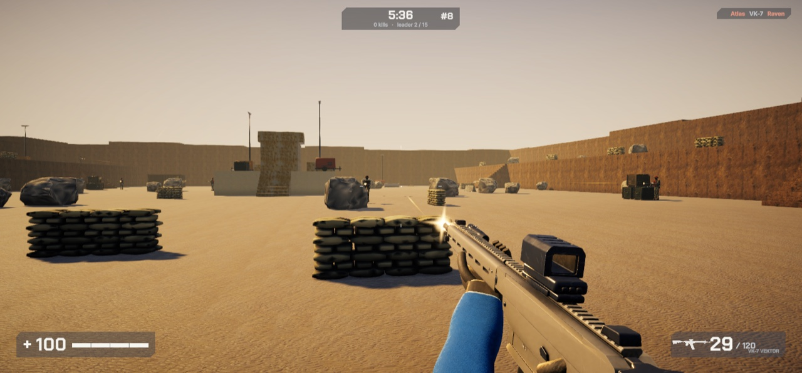
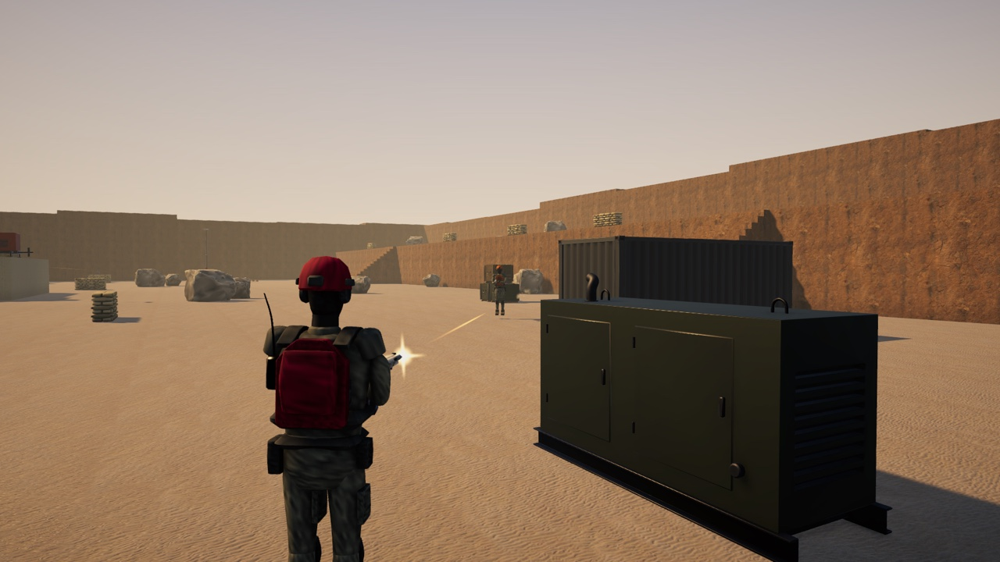
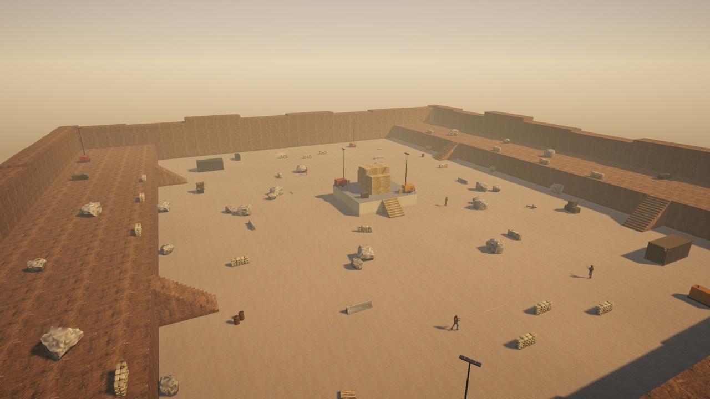

# Unity Direct MCP

**유니티 에디터가 곧 MCP 서버예요.** 패키지 하나 설치하고 버튼 한 번 누르면 Claude Code, Cursor, VS Code가 게임을 보고, 만들고, 직접 플레이해서 확인해요.

- **Python, Node.js, 계정 필요 없음.** 서버가 에디터 안에서 `127.0.0.1`로 돌아가요.
- **도구는 8개.** 그중 하나가 에디터 API 전체로 C#을 실행할 수 있어서, 필요한 도구가 없어서 막히는 일이 없어요.
- **AI가 스스로 검증.** 컴파일 에러, 콘솔 로그, 플레이 모드, 스크린샷으로 "작성 → 컴파일 → 수정 → 플레이 → 확인" 루프를 혼자 돌려요.
- **스크립트 리로드에도 안 끊김.** 처리 중이던 요청은 연결이 끊기는 대신 "리로드 중" 응답을 받고, 서버는 약 2초 안에 다시 떠요.

## 데모: 유니티로 옮긴 MOA FPS

AI 에이전트가 Direct MCP 도구만으로 새 Unity 6 프로젝트에 MOA FPS(C++/raylib 게임)를 다시 만들었어요. 이동, VK-7 소총, NavMesh 위의 봇 7명, 텍스트 맵 파일에서 가져온 Quarry 맵을 만든 다음, 원작의 Blender 모델, 사진 텍스처, 조명, HUD까지 옮겼어요.



| 사격하는 봇 (관전 카메라) | Quarry 맵 |
|---|---|
|  |  |

- **원작과 같은 수치.** 이동, 무기, 봇, 매치 값은 원작의 `.ini` 파일에서 실행 중에 그대로 읽어요.
- **원작과 같은 그래픽.** 원작 GLSL에 맞춘 URP 셰이더(버텍스 컬러, 팀 색, 사진 PBR 표면), 원작 뷰모델 코드대로 자세를 잡은 1인칭 총과 팔, 원작 HUD 코드대로 배치한 HUD.
- **에이전트가 스스로 검증.** 스크립트 작성 → `refresh_assets` + `unity_status`로 컴파일 에러 확인 → `execute_csharp`로 맵 가져오기(소품 82개, 스폰 18곳), NavMesh 굽기, 프리팹 생성 → `screenshot`으로 조명과 HUD 확인 → `play_mode` + `playtest`로 봇끼리 서로 찾아 쏘는 것과 에러가 없는 걸 확인했어요.
- **플레이 모드에서 데미지 계산 확인:** 37 m 헤드샷이 44 데미지 = 26 × 0.866(거리 감쇠) × 1.95(헤드).
- 헤드리스로만 검증했고, 마우스/키보드 조작감과 합성 사운드는 아직 사람이 확인하지 않았어요.

## 설치 (2분)

1. 유니티 → **Window → Package Manager → + → Add package from git URL**
   ```
   https://github.com/growing7696-cmyk/unity-direct-mcp.git?path=/Package
   ```
2. **Direct MCP** 창이 열려요. 초록불이면 서버가 켜진 거예요.
3. 쓰는 AI 도구 옆의 **Connect**를 누르면 프로젝트에 설정 파일이 생겨요.
   - Claude Code → `.mcp.json` + Claude 스킬(`.claude/skills/`)
   - Cursor → `.cursor/mcp.json`
   - VS Code (Copilot) → `.vscode/mcp.json`
4. 프로젝트 폴더에서 AI 도구를 열고 요청하세요.
   > "WASD로 움직이는 플레이어 캡슐을 만들고, 앞에 상자 5개를 놓은 다음, 플레이해서 스크린샷 보여줘."

Unity 2022.3 이상이 필요해요. Unity 6000.6(macOS)에서 테스트했어요.

## 도구

| 도구 | 하는 일 |
|---|---|
| `unity_status` | 씬, 플레이 모드, 컴파일 상태, **마지막 컴파일 에러**, 콘솔 에러 수 |
| `scene_hierarchy` | 오브젝트 트리와 컴포넌트 목록 |
| `inspect_object` | 컴포넌트의 모든 필드 값 (에셋도 가능) |
| `execute_csharp` | 에디터에서 C# 실행 (컴파일 약 0.3초). 결과와 로그 반환, 실행 취소(Undo) 한 번으로 되돌리기 가능 |
| `refresh_assets` | AI가 쓴 파일을 가져오고 컴파일 시작 |
| `play_mode` | 플레이 시작, 종료, 일시정지, 재개 |
| `read_console` | 콘솔 로그와 스택 트레이스 (리로드 후에도 유지) |
| `screenshot` | 게임/씬 카메라 화면을 이미지로 반환 |

## Claude 스킬

도구는 Claude에게 "무엇을 할 수 있는지"를 알려주고, 스킬은 "어떻게 잘하는지"를 알려줘요. Claude Code의 **Connect**를 누르면 프로젝트에 `.claude/skills/unity-direct-mcp/`도 함께 설치돼요. 스킬만 따로 설치하려면 **Claude skill → Install**을 누르세요.

- 바꾸기 전에 먼저 보기 (상태 → 하이어라키 → 검사). 오브젝트 이름을 추측하지 않아요.
- 컴파일 에러부터 고치고, 스크립트 리로드는 기다렸다가 다시 확인해요.
- 검증된 C# 레시피 사용: 실행 취소가 되는 오브젝트 생성, private 필드 설정, 렌더 파이프라인에 맞는 머티리얼(분홍색 방지), 프리팹, 태그/레이어, 입력 시스템 확인, 씬, UI
- "완료"라고 말하기 전에 직접 플레이하고 스크린샷으로 확인해요.

[`references/recipes.md`](Package/Skills~/unity-direct-mcp/references/recipes.md)의 모든 레시피는 실제 유니티 에디터에서 실행해서 검증했어요.

## 보안

서버는 `127.0.0.1`에서만 열리고, 외부 웹페이지에서 오는 요청은 거부해요. `execute_csharp`는 에디터가 할 수 있는 모든 걸 할 수 있으니 믿을 수 있는 AI 도구만 연결하세요. 창에서 언제든 서버를 끌 수 있어요.

## 라이선스

MIT. C# 코드 실행 방식은 [MCP for Unity](https://github.com/CoplayDev/unity-mcp)(MIT)를 참고했어요.
